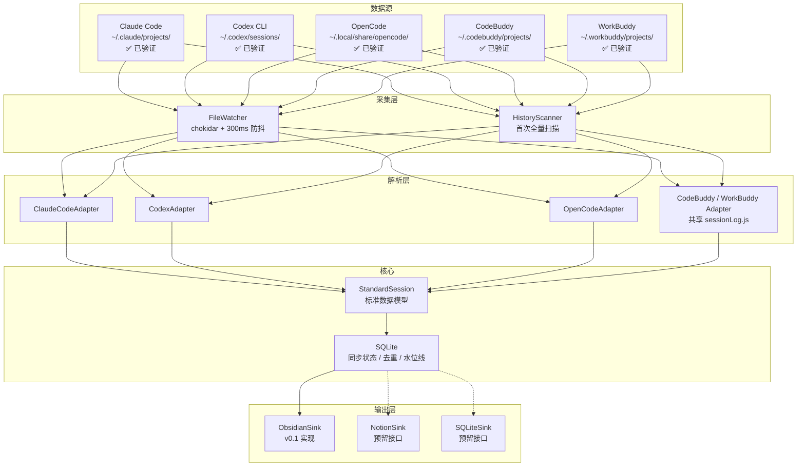

# AISessionLog Technical Design

版本：v0.1 "Spark" · 2026-03-30

## 一、技术选型

- **运行时**：Node.js 20+ 。理由是三个工具的 Adapter 需要大量文件 I/O 和 JSON 解析，Node.js 生态成熟（chokidar、better-sqlite3、commander），开发速度快，跨平台（macOS / Linux）无障碍，打包为单文件可执行文件使用 pkg 或 bun build。
- **文件监听**：chokidar 3.x，支持 macOS FSEvents 和 Linux inotify，配合 300ms 防抖避免高频触发。
- **本地数据库**：sql.js（纯 JS SQLite 实现），无需原生编译，跨平台零依赖，单文件存储。用于状态存储和 OpenCode 数据源读取。
- **CLI 框架**：commander 12.x（交互式 init 向导 v0.1 暂未实现）。
- **测试**：vitest，针对每个 Adapter 编写基于真实样本文件的单元测试。

## 二、系统架构



## 三、标准数据模型

```typescript
// 来源工具枚举
type SourceType = 'claude_code' | 'codex_cli' | 'opencode'

// 会话状态
type SessionStatus =
  | 'complete'    // 正常完整会话
  | 'partial'     // 文件不完整（如写到一半）
  | 'corrupted'   // 解析失败
  | 'source_missing' // 源文件已被清理

// 内容块类型
interface ContentBlock {
  type: 'text' | 'code' | 'tool_use' | 'tool_result' | 'image'
  // 原始完整内容，不截断
  content: string
  // type === 'code' 时的语言标识
  language?: string
  // type === 'tool_use' 时的工具名称
  toolName?: string
  // type === 'tool_use' 的调用 ID，用于匹配 tool_result
  toolUseId?: string
}

// 消息事件类型（区分对话轮次与系统事件）
type MessageRole = 'user' | 'assistant' | 'system'
type EventType =
  | 'message'       // 普通对话轮次
  | 'tool_call'     // 工具调用事件
  | 'tool_result'   // 工具返回事件
  | 'summary'       // 上下文压缩摘要

interface StandardMessage {
  id: string
  role: MessageRole
  eventType: EventType
  // 供全文搜索和 Markdown 展示的纯文本
  renderedText: string
  // 结构化内容块（完整保留，包括 tool_result 原始内容）
  contentBlocks: ContentBlock[]
  // 原始内容（源格式，不做任何处理）
  rawContent: unknown
  timestamp: Date
  // 区分 prompt_tokens 和 completion_tokens
  promptTokens?: number
  completionTokens?: number
}

interface StandardSession {
  // 内部唯一标识
  id: string
  // 原始工具的会话 ID
  sourceId: string
  source: SourceType
  status: SessionStatus

  // 上下文
  project: string          // 从路径提取的项目名
  projectPath: string      // 原始项目路径
  workingDir?: string
  model?: string           // 使用的模型名称（从 rawMeta 提取）

  // 时间
  createdAt: Date
  updatedAt: Date
  ingestedAt: Date         // AISessionLog 写入时间

  // 消息
  messages: StandardMessage[]

  // 来源追溯（用于调试和回溯）
  sourcePath: string       // 原始文件绝对路径
  parserVersion: string    // 解析器版本号
  contentHash: string      // 原始文件内容 hash，用于增量判断

  // 解析过程中的警告（不阻断流程，但记录异常）
  parseWarnings: string[]

  // 保留各工具特有的原始元数据
  rawMeta?: Record<string, unknown>
}
```

## 四、各工具 Adapter

### AdapterInterface

```typescript
interface AdapterInterface {
  // 判断某个文件是否属于该工具
  canHandle(filePath: string): boolean

  // 解析文件，返回一个或多个 StandardSession
  // 解析失败时返回 status: 'corrupted' 的 session，不抛出异常
  parse(filePath: string): Promise<StandardSession[]>

  // 适配器标识与版本
  readonly source: SourceType
  readonly version: string
}
```

---

### ClaudeCodeAdapter ✅ 已验证

**存储路径**: `~/.claude/projects/<encoded-cwd>/<sessionId>.jsonl`

**目录结构**:
```
~/.claude/projects/
├── -Users-yhzhu-workgroup-connexustravel-IAM/
│   ├── 04ad8c8f-963d-4b85-8210-2c7ad70d697a.jsonl
│   └── ...
└── ...
```

**文件格式**: JSONL（每行一个 JSON 对象）

**记录类型** (`type` 字段):
- `type: "user"` - 用户消息（128 条，约 47%）
- `type: "assistant"` - AI 回复（88 条，约 32%）
- `type: "file-history-snapshot"` - 文件历史快照（34 条，约 12%）
- `type: "system"` - 系统命令/响应（19 条，约 7%）- 如 `/resume`, `/status`, `/model` 命令
- `type: "progress"` - 进度更新（10 条）- AI 思考过程中的中间状态
- `type: "queue-operation"` - 队列操作（2 条）- 命令队列相关
- `type: "last-prompt"` - 最后提示（2 条）- 会话结束时的提示

**解析策略**:
- 必须保留：`user`, `assistant`
- 可选保留：`system`（包含用户命令历史）
- 可跳过：`file-history-snapshot`, `progress`, `queue-operation`, `last-prompt`（元数据）

**关键字段映射**:

| 原始字段 | StandardSession/Message 字段 | 备注 |
| --- | --- | --- |
| `sessionId` | `sourceId` | 会话唯一标识 |
| `cwd` | `projectPath` | `basename(cwd)` 作为 `project` |
| `uuid` | `id` | 消息唯一标识 |
| `type` | 过滤条件 | `human` → `user`, `assistant` → `assistant` |
| `message.role` | `role` | 角色 |
| `message.content` | `contentBlocks` | 字符串或数组，逐块解析 |
| `message.content[].type` | `ContentBlock.type` | `text`/`tool_use`/`tool_result` |
| `timestamp` | `timestamp` | ISO 8601 格式 |
| `version` | `rawMeta.claudeVersion` | Claude 版本号 |
| `gitBranch` | `rawMeta.gitBranch` | Git 分支 |

**样本数据**:
```json
{"type":"user","sessionId":"04ad8c8f...","cwd":"/Users/yhzhu/.../IAM","message":{"role":"user","content":"who are you "},"uuid":"57f925ba...","timestamp":"2026-03-01T08:16:47.419Z"}
{"type":"assistant","sessionId":"04ad8c8f...","message":{"role":"assistant","content":[{"type":"text","text":"..."}]},"timestamp":"2026-03-01T08:16:48.156Z"}
```

**renderedText 生成规则**: 提取所有 `type === 'text'` 的 block 内容拼接，`tool_use` 替换为 `[调用工具：{toolName}]` 占位，`tool_result` 超过 500 字符时截断为 `[工具返回：{前 500 字符}...]`，完整内容保留在 contentBlocks 中。

**样本文件**: `samples/claude_code/*.jsonl` (4 个会话文件)

---

### CodexAdapter ✅ 已验证

**存储路径**: `~/.codex/sessions/YYYY/MM/DD/rollout-<sessionId>.jsonl`

**目录结构**:
```
~/.codex/sessions/
└── 2026/
    └── 03/
        └── 03/
            └── rollout-2026-03-03T02-10-29-019cafbe-98d7-7b71-9589-fda8fe862123.jsonl
```

**文件格式**: JSONL（每行一个 JSON 对象）

**记录类型** (`type` 字段):
- `session_meta` - 会话元数据（1 条/会话）- 包含 cwd、model、originator、cli_version 等
- `response_item` - 对话内容（127 条，约 52%）- user/assistant/developer 消息，含 tool_call/tool_result
- `event_msg` - 系统事件（93 条，约 38%）- token_count、agent_reasoning、user_message 等
- `turn_context` - 上下文信息（20 条）- approval_policy、sandbox_policy、model_context_window 等

**解析策略**:
- 必须保留：`session_meta`（提取会话级元数据）, `response_item` 且 `payload.role` 为 `user`/`assistant`
- 可选保留：`event_msg` 中的 `user_message`（用户输入历史）
- 可跳过：`turn_context`, `event_msg` 中的 `token_count`/`agent_reasoning`（仅用于调试）

**关键字段映射**:

| 原始字段 | StandardSession/Message 字段 | 备注 |
| --- | --- | --- |
| `payload.id` | `sourceId` | 会话唯一标识 (UUID v7) |
| `payload.cwd` | `projectPath` | 从 `session_meta` 提取 |
| `timestamp` | `timestamp` | ISO 8601 格式 |
| `payload.role` | `role` | `user`/`assistant`/`developer` |
| `payload.content[]` | `contentBlocks` | 数组，`type: "input_text"` |
| `payload.content[].text` | `content` | 实际文本内容 |
| `payload.model` | `rawMeta.model` | 模型名称，如 `gpt-5.3-codex` |
| `payload.originator` | `rawMeta.originator` | `Codex Desktop` / `VSCode` |
| `payload.cli_version` | `rawMeta.cliVersion` | Codex 版本号 |

**样本数据**:
```json
{"timestamp":"2026-03-02T18:11:10.924Z","type":"session_meta","payload":{"id":"019cafbe-...","cwd":"/Users/yhzhu/Documents/New project","model_provider":"openai","cli_version":"0.107.0-alpha.5"}}
{"timestamp":"2026-03-02T18:11:10.931Z","type":"response_item","payload":{"type":"message","role":"user","content":[{"type":"input_text","text":"apisix 与 Spring Authorization Server 集成"}]}}
```

**解析策略**:
1. 先读取 `session_meta` 行提取会话级元数据（cwd、model、version）
2. 过滤 `response_item` 且 `payload.role` 为 `user`/`assistant` 的行作为对话消息
3. 忽略 `event_msg` 和 `turn_context` 类型（仅用于上下文，不同步）

**样本文件**: `samples/codex/*.jsonl` (3 个会话文件，最大 8.5MB)

---

### OpenCodeAdapter ✅ 已验证

**存储路径**: `~/.local/share/opencode/opencode.db` (SQLite)

**数据库大小**: 约 763MB（含大量 tool_output）

**核心发现**: OpenCode 的对话内容存储在 **两张表** 中：
- `message` 表：仅存元数据（角色、token 统计、finish 状态），**不包含实际对话文本**
- `part` 表：存实际内容（文本回复、推理过程、工具调用输入/输出）

只查 `message` 表会得到 `role` + `tokens` + `finish: "tool-calls"` 等元数据，渲染出来全是无意义的 `🤖 **build**` 文字。必须 JOIN `part` 表才能获取真实内容。

**表结构**:
```sql
CREATE TABLE session (
  id text PRIMARY KEY,        -- 如 "ses_2d29da5f3ffeabxMRvwZZa7cp5"
  project_id text NOT NULL,
  slug text NOT NULL,         -- 人类可读名称，如 "nimble-lagoon"
  directory text NOT NULL,    -- 项目目录
  title text NOT NULL,        -- 会话标题
  time_created integer NOT NULL,
  time_updated integer NOT NULL
);

CREATE TABLE message (
  id text PRIMARY KEY,
  session_id text NOT NULL,
  time_created integer NOT NULL,
  time_updated integer NOT NULL,
  data text NOT NULL          -- JSON 格式，仅含元数据
);

CREATE TABLE part (
  id text PRIMARY KEY,
  message_id text NOT NULL,   -- 关联到 message.id
  session_id text NOT NULL,
  time_created integer NOT NULL,
  time_updated integer NOT NULL,
  data text NOT NULL          -- JSON 格式，含实际内容
);
```

**message.data 字段** (仅元数据):
```json
// assistant 消息
{
  "role": "assistant",
  "time": {"created": 1774582913567, "completed": 1774582918333},
  "parentID": "msg_xxx",
  "modelID": "glm-4.7",
  "providerID": "zhipuai-coding-plan",
  "mode": "build",
  "agent": "build",
  "tokens": {"total": 27101, "input": 93, "output": 256, "reasoning": 128},
  "finish": "tool-calls"    // 或 "stop"
}

// user 消息
{
  "role": "user",
  "time": {"created": 1774582913561},
  "summary": {"diffs": [...]},
  "agent": "build"
}
```

**part.data 字段 — 实际对话内容** (按 type 分类):

| part type | 数量 | 内容说明 | 处理方式 |
| --- | --- | --- | --- |
| `tool` | 37,931 | 工具调用，含 `state.input`(调用参数) 和 `state.output`(执行结果) | ✅ 渲染为 tool_use + tool_result |
| `step-start` | 33,825 | 步骤开始标记 | ❌ 跳过（内部状态） |
| `step-finish` | 33,645 | 步骤结束标记，含 finish reason 和 token 统计 | ❌ 跳过（内部状态） |
| `reasoning` | 28,906 | 模型推理过程（chain-of-thought） | ✅ 渲染为 💭 Reasoning 前缀文本 |
| `patch` | 17,697 | 文件变更摘要（hash + 文件列表） | ❌ 跳过（变更元数据） |
| `text` | 12,773 | **实际对话文本**（用户输入、AI 回复） | ✅ 直接渲染 |
| `file` | 357 | 用户附加的文件引用（@filename） | ❌ 跳过 |
| `compaction` | 48 | 上下文自动压缩标记 | ❌ 跳过 |

**part type 示例**:
```json
// text — 实际对话文本
{"type":"text","text":"我来帮你调查一下这个问题。","time":{"start":1774582913567,"end":1774582918333}}

// reasoning — 推理过程
{"type":"reasoning","text":"用户要我调查 attachments 字段显示为文本框的问题...","time":{"start":1774582913567,"end":1774582919317}}

// tool — 工具调用
{"type":"tool","callID":"call_03e11d","tool":"edit","state":{"status":"completed","input":{"filePath":"/path/to/file","oldString":"...","newString":"..."},"output":"..."}}
```

**关键字段映射**:

| 原始字段 | StandardSession/Message 字段 | 备注 |
| --- | --- | --- |
| `session.id` | `sourceId` | 会话唯一标识 |
| `session.slug` | `rawMeta.slug` | 人类可读名称 |
| `session.directory` | `projectPath` | 项目目录 |
| `session.title` | `rawMeta.title` | 会话标题 |
| `message.id` | `id` | 消息唯一标识 |
| `message.data.role` | `role` | `user`/`assistant` |
| `part(type=text).text` | `contentBlocks[type=text]` | 实际对话文本 |
| `part(type=reasoning).text` | `contentBlocks[type=text]` (前缀 💭) | 推理过程 |
| `part(type=tool).tool` | `contentBlocks[type=tool_use].toolName` | 工具名称 |
| `part(type=tool).state.input` | `contentBlocks[type=tool_use].content` | 工具调用参数 |
| `part(type=tool).state.output` | `contentBlocks[type=tool_result].content` | 工具执行结果 |
| `message.data.model.modelID` | `model` | 模型，如 `glm-4.7` |
| `message.data.tokens` | `promptTokens` / `completionTokens` | Token 统计 |

**大库与增量**:
- `opencode.db` 超过 **2 GiB** 时 sql.js 无法加载（当前库 2.6 GB），自动回退到系统 `sqlite3` CLI（`-json` + `mode=ro`，逐个 session 查询）
- 只读取 `time_updated > 上次同步时间 - 5 分钟` 的 session，避免每次同步都重建 1000+ 篇笔记（实测全量 48s → 增量 2s）

**解析策略**:
1. 用 prepared statement 逐 session 查询（763MB 数据库，避免全量加载）
2. 查询 `message LEFT JOIN part`，按 `message.time_created ASC, part.time_created ASC` 排序
3. 按 message 分组聚合 part 记录
4. 对每个 message 的 parts：提取 `text`（文本）、`reasoning`（推理）、`tool`（工具调用），跳过 `step-start`/`step-finish`/`patch`/`file`/`compaction`
5. 只保留有实际内容的 message（过滤后 contentBlocks 非空的）

**查询语句**:
```sql
-- 逐 session 查询消息及其 parts
SELECT
  m.id AS mid,
  m.time_created AS mtime,
  m.data AS mdata,
  p.id AS pid,
  p.data AS pdata
FROM message m
LEFT JOIN part p ON m.id = p.message_id
WHERE m.session_id = ?
ORDER BY m.time_created ASC, p.time_created ASC
```

### CodeBuddyAdapter / WorkBuddyAdapter ✅ 已验证

**输入**:
- CodeBuddy: `~/.codebuddy/projects/<encoded-cwd>/<sessionId>.jsonl`
- WorkBuddy: `~/.workbuddy/projects/<encoded-cwd>/<sessionId>.jsonl`

CodeBuddy Code 的存储与 Claude Code 同构（JSONL，一行一条记录），但工具调用是**独立记录**而非 content block。WorkBuddy 桌面端使用完全相同的记录格式（同一套 `codebuddy.ai/*` 元数据），因此解析实现集中在 `src/adapters/sessionLog.js`，两个 Adapter 只负责路径判定与 `source` / id 前缀。

**记录类型**:

| `type` | 说明 | 处理 |
| --- | --- | --- |
| `session-meta` | 会话元数据（agent / 标题） | `rawMeta.agent`、`rawMeta.aiTitle` |
| `message` | user / assistant 文本 | `contentBlocks[type=text]` |
| `function_call` | 工具调用 | `contentBlocks[type=tool_use]` |
| `function_call_result` | 工具返回 | `contentBlocks[type=tool_result]` |
| `reasoning` | 模型思考过程 | v0.1 丢弃，仅计数 `rawMeta.reasoningRecords` |
| `summary` / `ai-title` | 首条请求 / AI 标题 | `rawMeta.summary`、`rawMeta.aiTitle` |
| `turn-metrics` / `model-usage` | 轮次时延 / token 用量 | `rawMeta.turns`、`rawMeta.tokens` |
| `credit-usage` | 按额度计费的调用（图片生成等） | `rawMeta.credits` |
| `file-history-snapshot` | 文件快照 | 忽略 |

**字段映射**:

| 原始字段 | 标准字段 | 备注 |
| --- | --- | --- |
| `record.sessionId` | `sourceId` | |
| `record.cwd` | `projectPath` | 目录名把 `/` 编码成 `-`，不可逆，必须取 `cwd` 字段 |
| `record.timestamp` | `timestamp` | 毫秒整数（如 `1792491547840`） |
| `message.content[].text` | `contentBlocks[type=text].content` | `input_text` / `output_text` |
| `function_call.name` / `.arguments` | `tool_use.toolName` / `.content` | `arguments` 已是 JSON 字符串 |
| `function_call.callId` | `tool_use.toolUseId` | 与返回记录按 `callId` 关联 |
| `function_call_result.output.text` | `tool_result.content` | 长输出可能已截断，完整内容在 `<sessionId>/tool-results/*.txt` |
| `providerData.rawUsage` | `rawMeta.tokens` | 按 `(messageId, stepSeq)` 去重后累加 |
| `providerData.model` | `model` | |

**解析策略**:
1. 同一 `id` 可能因流式输出被重复写入（`function_call` 参数增量），按 `id` 去重保留最后一条
2. 纯 CLI 噪音的会话（只有 `/model` 切换、本地命令回显）返回空数组，不产生记录
3. `reasoning` 不进入消息流，避免检索噪音
4. 子 Agent 转录（`<encoded-cwd>/<sessionId>/subagents/agent-*.jsonl`）一并解析，各自独立成会话

**噪音清洗规则**（`src/core/utils.js` 的 `stripCliMetadata`）:
- `<system-reminder>`、`<command-name>`、`<command-message>`、`<local-command-stdout>`
- `<task-notification>`（含其后的使用说明）
- `<cb_summary>` / `<conversation_history_summary>`（上下文压缩注入的摘要，可嵌套，需循环清洗）

**WorkBuddy 差异**:
- `input_image` 把图片引用再包一层（`{ type: 'input_image', image: { type: 'image_blob_ref', ... } }`），解析时摊平成 `image` block
- 没有 `turn-metrics` / `model-usage`，改用 `credit-usage`（`providerData.credit` 累加到 `rawMeta.credits`）
- 一个文件里可能有几十条 `session-meta`（每次写入追加一条），取最后一条有效值
- ObsidianSink 会把 `image` block 渲染成 `> 图片：<blob_path>`

**实测**:
- CodeBuddy: 139 个文件（含 21 个子 Agent 转录）/ 99 个有效会话 / 15,157 条消息，解析 0 错误；40 个纯噪音文件被跳过
- WorkBuddy: 28 个文件 / 28 个会话 / 4,018 条消息，解析 0 错误；6 张截图引用、39.97 credits

> WorkBuddy 的 `~/.workbuddy/workbuddy.db` 里还有 20 条 session 元数据（标题、状态、用量），但本机仅 12 条能对上 jsonl 转录，其余 8 条转录已被清理。数据库是 WAL 模式，sql.js 读不到未 checkpoint 的写入，因此 v0.1 只接文件，不读该库。

## 五、SQLite 状态存储

数据库文件存储在 `~/.config/aisessionlog/state.db`，使用 sql.js（纯 JS SQLite 实现），负责三件事：记录已处理文件的 hash 和水位线（增量判断）、存储 StandardSession 的元数据索引（不存全量内容，全量内容在 Markdown 文件中）、记录解析错误和警告日志。

所有 SQL 查询均使用 prepared statement 参数化查询（`stmt = db.prepare(sql); stmt.bind([params])`），防止文件路径等外部输入导致的 SQL 注入。SELECT 查询通过 `stmt.step()` + `stmt.get()` 逐行迭代，避免一次性加载大量数据到内存。

```sql
CREATE TABLE sync_state (
  file_path     TEXT PRIMARY KEY,
  content_hash  TEXT NOT NULL,
  last_synced   DATETIME NOT NULL,
  session_count INTEGER DEFAULT 0
);

CREATE TABLE sessions (
  id            TEXT PRIMARY KEY,
  source_id     TEXT NOT NULL,
  source        TEXT NOT NULL,
  project       TEXT,
  status        TEXT NOT NULL,
  created_at    DATETIME,
  updated_at    DATETIME,
  ingested_at   DATETIME NOT NULL,
  source_path   TEXT,
  has_warnings  INTEGER DEFAULT 0
);

CREATE TABLE parse_errors (
  id          INTEGER PRIMARY KEY AUTOINCREMENT,
  file_path   TEXT NOT NULL,
  error_msg   TEXT NOT NULL,
  occurred_at DATETIME NOT NULL
);
```

## 六、ObsidianSink

### 目录结构

```
<vault-root>/AISessionLog/
├── my-project/
│   ├── claude_code/
│   │   └── 2026-03/
│   │       └── 20260328_abc123.md
│   ├── codex_cli/
│   │   └── 2026-03/
│   │       └── 20260327_def456.md
│   └── opencode/
│       └── 2026-03/
│           └── 20260325_ghi789.md
└── another-project/
    └── ...
```

文件命名规则：`{YYYYMMDD}_{sourceId 前 8 位}.md`，不在文件名中包含项目名（项目名写在 frontmatter 里），避免项目 rename 导致文件路径频繁变化。按月归档（`YYYY-MM/` 子目录）防止单目录文件过多。

### Markdown 文件格式

```markdown
---
id: "uuid-xxxx"
source: "claude_code"
source_id: "original-session-id"
project: "my-project"
project_path: "/Users/name/code/my-project"
model: "claude-opus-4-5"
created_at: 2026-03-28T10:23:00
updated_at: 2026-03-28T11:45:00
ingested_at: 2026-03-28T12:00:00
message_count: 12
has_code: true
has_tool_calls: true
status: "complete"
tags: [ai-session, claude_code, my-project]
source_missing: false
---

# my-project · 2026-03-28 10:23

> Claude Code · claude-opus-4-5 · 12 条消息

---

**User** `10:23:01`

useEffect 依赖数组导致无限循环...

**Assistant** `10:23:08`

这个问题通常由以下原因引起...

```javascript
useEffect(() => {
  fetchData();
}, []);
```

<details>
<summary>🔧 工具调用：read_file · src/hooks/useData.ts</summary>

```
[200 行文件内容完整展示]
```

</details>

---

*AISessionLog v0.1 · 原始 ID: original-session-id · [查看原始文件](file:///path/to/source)*
```

### 增量更新策略

每个文件末尾维护一个 HTML 注释水位线：`<!-- aisessionlog:last_message_id:xxx -->`。每次同步只追加水位线之后的新消息，不重写整个文件。这样用户在文件顶部添加的 Obsidian 链接、标签等不会被破坏——但注意：AISessionLog 管理区域（水位线以下）的内容会被覆盖，用户不应在此区域手动编辑。

## 七、CLI 设计

```bash
# 初始化（交互式向导）
asl init

# 首次全量导入历史记录
asl pull

# 启动后台实时监听
asl watch

# 手动触发一次同步
asl sync

# 查看同步状态
asl status

# 查看错误日志
asl logs --errors
```

### 配置文件

路径：`~/.config/aisessionlog/config.json`

```json
{
  "version": "0.1",
  "sources": {
    "claude_code": {
      "enabled": true,
      "path": "~/.claude/projects"
    },
    "codex": {
      "enabled": true,
      "path": "~/.codex/sessions"
    },
    "opencode": {
      "enabled": true,
      "mode": "sqlite"
    }
  },
  "sink": {
    "type": "obsidian",
    "vault": "~/Documents/MyVault",
    "folder": "AISessionLog"
  },
  "sync": {
    "mode": "watch",
    "debounceMs": 300
  },
  "toolResult": {
    "foldThresholdChars": 500
  }
}
```

## 八、非功能需求

| 指标 | 目标 |
| --- | --- |
| 单个 session 解析时间 | < 500ms |
| 全量历史扫描（1000 个会话） | < 30s |
| 后台监听 CPU 占用（空闲时） | < 2% |
| 内存占用（watch 模式） | < 80MB |
| Markdown 文件最大体积 | 无硬限制，tool_result 超 500 字符自动折叠 |

## 九、边缘场景处理

- **JSONL 文件写到一半（AI 正在输出时读取）**：按已有完整行解析，标记 `status: 'partial'`，下次同步时重新检测。
- **同名项目来自不同 source**：目录结构已按 source 隔离，不会冲突。
- **源文件被清理**：Markdown 文件保留，frontmatter 中 `source_missing: true`，SQLite 中更新状态，不删除任何内容。
- **解析完全失败**：记录错误到 `parse_errors` 表，在 `asl logs --errors` 中展示，不影响其他文件的处理流程。
- **Vault 路径不可访问**：`asl watch` 启动时执行 `healthCheck()`，不可访问时输出明确错误信息并退出，不静默失败。
